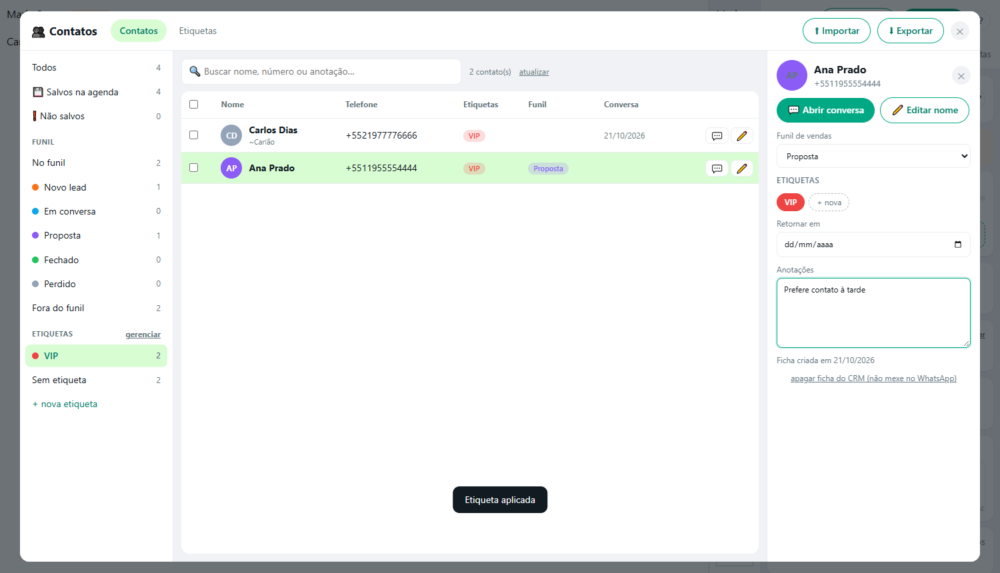
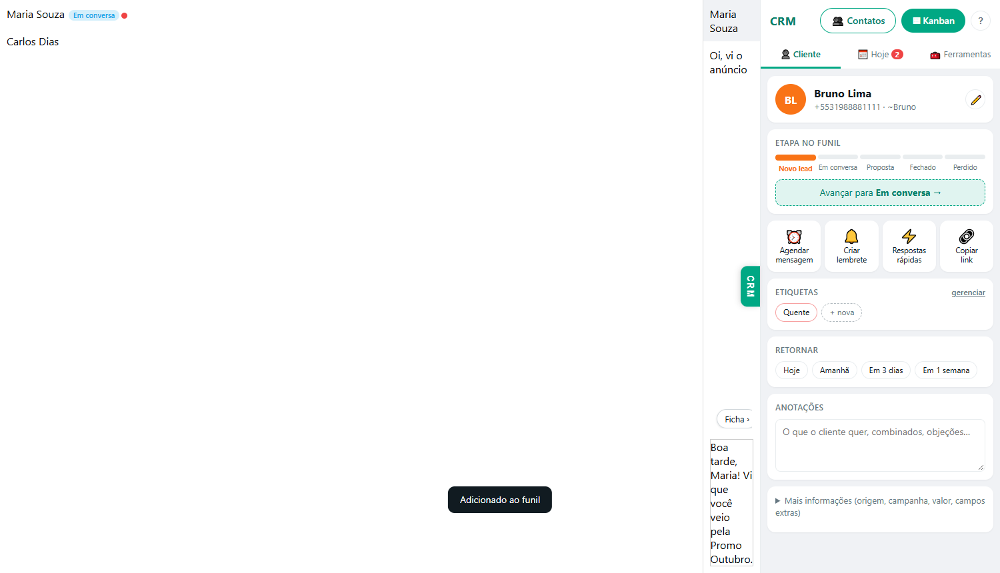
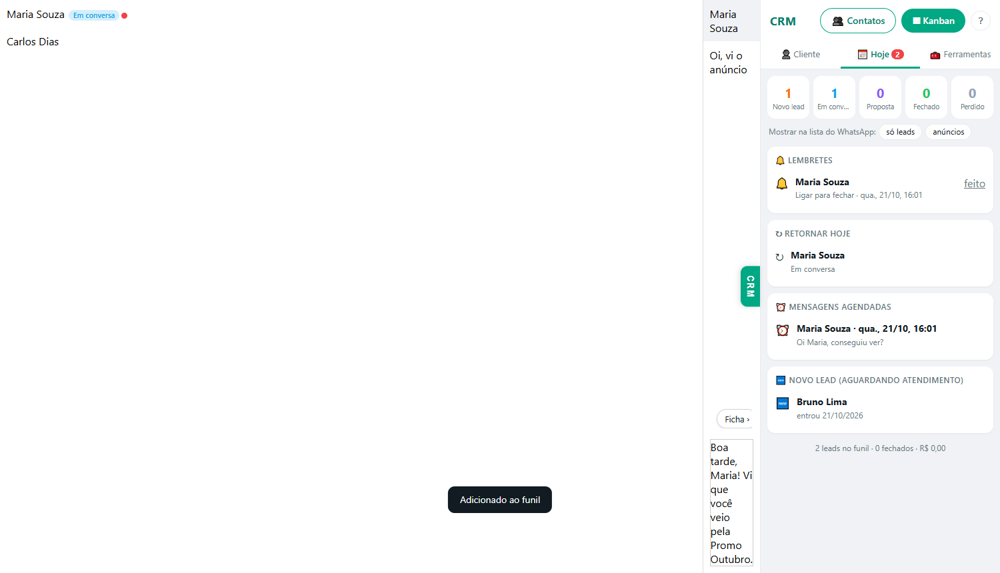
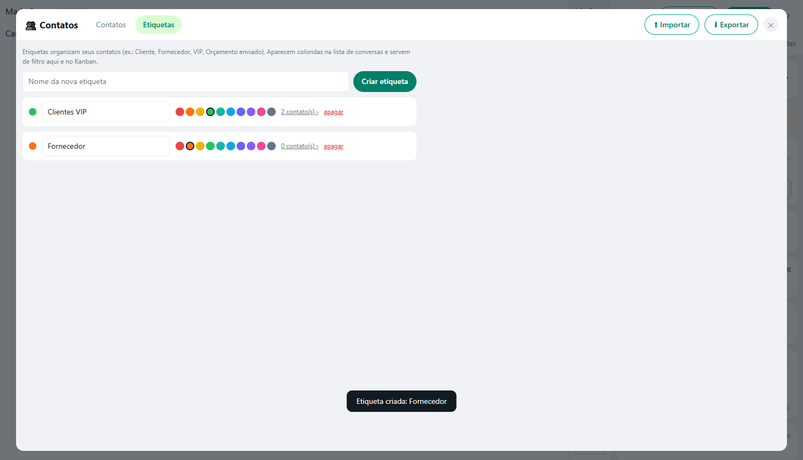

# CRM de Leads para WhatsApp Web — grátis e open source

**Extensão gratuita e de código aberto que transforma o WhatsApp Web num CRM**: ficha do cliente, funil de vendas em Kanban, etiquetas coloridas, gerenciador de contatos, agendar mensagens, lembretes, respostas rápidas e robôs de resposta automática. Uma alternativa **grátis** a extensões pagas de CRM para WhatsApp, sem mensalidade, sem login e sem servidor.

**[⬇ Baixar a versão mais recente (ZIP)](../../releases/latest)** · [Instalação](#instalação-1-minuto) · [Perguntas frequentes](#perguntas-frequentes) · [English](#english)

**100% local.** Não tem servidor, não tem login e não manda nenhum dado para fora. Tudo fica salvo no seu próprio navegador.

> ⚠️ Projeto independente, sem nenhuma ligação com o WhatsApp ou a Meta. Ele usa o WhatsApp Web de forma não oficial, então use com bom senso (veja [Uso responsável](#uso-responsável)).

## Recursos

- **Ficha do cliente** ao lado da conversa:
  - etapa do funil e botão "Avançar";
  - etiquetas, anotações que salvam sozinhas e data para retornar;
  - valor, origem, campanha e campos extras.
- **Barra de atalhos** logo acima do campo de mensagem: pôr no funil, etiqueta, respostas, agendar, lembrar e salvar contato.
- **Contatos em tela cheia:**
  - mostra a agenda e quem conversa com você sem estar salvo;
  - filtros: não salvos, etapa e etiqueta;
  - salvar ou editar o nome na agenda do celular;
  - ações em massa: etiquetar, pôr no funil, salvar na agenda, criar grupo;
  - importar e exportar planilha.
- **Etiquetas coloridas:** criar, renomear, trocar a cor e apagar. Aparecem na lista de conversas do WhatsApp.
- **Kanban** dentro do WhatsApp, com arrastar e soltar, colunas editáveis e filtros por origem, campanha, etiqueta e data.
- **Hoje:** retornos do dia, lembretes (com notificação do Windows/macOS), mensagens agendadas e leads novos.
- **Leads de anúncio:** quem chega por anúncio Click-to-WhatsApp (Facebook/Instagram) entra sozinho no funil, já com a campanha. Na aba de campanhas aparecem custo por lead, conversão e retorno.
- **Respostas rápidas:**
  - digite `/` no campo de mensagem;
  - variáveis `{primeiro_nome}`, `{saudacao}`, `{campanha}`…;
  - pastas e sequências de mensagens.
- **Robôs:** só respondem a quem te escreveu. Disparam por palavra-chave, primeira mensagem do dia ou do cliente, ou fora do horário.
- **Privacidade:** desfoca mensagens, nomes, prévias e fotos (passe o mouse para ver).
- **Atalhos de teclado:** `Alt+1…9` muda a etapa e `Esc` fecha janelas.
- Exportar planilha e fazer backup/restaurar.

| Ficha do cliente | Hoje | Etiquetas |
|---|---|---|
|  |  |  |

## Instalação (1 minuto)

Funciona no Chrome, Edge, Brave e Opera.

1. Baixe o ZIP da **[última versão](../../releases/latest)** (ou **Code → Download ZIP**). Extraia numa pasta que você não vai apagar.
2. Abra `chrome://extensions` (no Edge: `edge://extensions`).
3. Ligue o **Modo do desenvolvedor**, no canto superior direito.
4. Clique em **Carregar sem compactação** e escolha a pasta extraída (a que tem o `manifest.json`).
5. Abra <https://web.whatsapp.com>. Um tour rápido mostra onde fica cada coisa; o botão **?** no painel mostra de novo.

**Para atualizar:** troque os arquivos da pasta pelos novos, clique no ícone de recarregar no card da extensão e dê F5 no WhatsApp Web.

## Como usar no dia a dia

1. Abra uma conversa e use a **barra** acima do campo de mensagem, ou a **ficha** no painel à direita.
2. De manhã, abra a aba **Hoje** para ver quem precisa de retorno.
3. Use o **Kanban** para ver o funil inteiro e arrastar os cartões.
4. Use **Contatos** para organizar a agenda, as etiquetas e quem ainda não está salvo.

## Privacidade e segurança

- Os dados (fichas, etiquetas, notas, agendamentos) ficam no `chrome.storage.local` do seu navegador. **Faça backup** em Ferramentas → Configurar funil → Backup.
- A extensão só tem acesso a `web.whatsapp.com` e não faz requisições para servidores externos.
- O motor [WA-JS](https://github.com/wppconnect-team/wa-js) (pasta `lib/`) vem por padrão com envio de estatísticas ao Google Analytics e com servidores de terceiros para prévia de links. Aqui isso fica **desligado** (`wpp-config.js`) e **bloqueado na rede** (`rules.json`).
- O código é pequeno e legível. Antes de instalar qualquer extensão que lê seu WhatsApp, leia o código. Esta foi feita para isso.

## Uso responsável

- Esta extensão **não faz disparo em massa**, de propósito. Mandar mensagem automática para listas de pessoas que não falaram com você viola os termos do WhatsApp e é a forma mais rápida de ter o número banido.
- Os robôs só respondem a quem te escreveu, no máximo 1 vez a cada 30 minutos por pessoa.
- Para disparos e automação em grande volume, use a **API oficial do WhatsApp Business** (por exemplo, com o [wacrm](https://github.com/ArnasDon/wacrm) ou o [Chatwoot](https://github.com/chatwoot/chatwoot)).
- Você é responsável pelo uso que fizer. Respeite a LGPD e o consentimento dos seus contatos.

## Estrutura do código

| Arquivo | O que faz |
|---|---|
| `manifest.json` | Declaração da extensão (Manifest V3) |
| `wpp-config.js` | Desliga analytics e servidores externos do WA-JS (carrega antes dele) |
| `lib/wppconnect-wa.js` | [WA-JS](https://github.com/wppconnect-team/wa-js) 4.7.1 (Apache-2.0), sem alterações |
| `bridge-main.js` | Ponte entre a página do WhatsApp (WA-JS) e a extensão |
| `shared.js` | Modelo de dados e utilitários |
| `content.js` | Painel lateral (Cliente / Hoje / Ferramentas) e componentes |
| `toolbar.js` | Barra na conversa, `/` respostas rápidas, atalhos e tour |
| `contacts.js` | Gerenciador de contatos e etiquetas em tela cheia |
| `automation.js` | Robôs de resposta, mensagens agendadas e lembretes |
| `board.html/js/css` | Kanban, lista, campanhas e configurações |
| `background.js` | Abre o funil, notificações e "abrir conversa" |
| `rules.json` | Bloqueio de rede para domínios de analytics/prévia |

Se o WhatsApp atualizar e algo parar de funcionar, normalmente basta trocar `lib/wppconnect-wa.js` pela versão mais nova do WA-JS (pasta `dist/` do pacote npm `@wppconnect/wa-js`).

## Contribuindo

Issues e pull requests são bem-vindos. Mantenha o espírito do projeto:
- tudo local;
- sem dependências de servidor;
- sem disparo em massa;
- interface simples, em português.

## Perguntas frequentes

**Existe CRM grátis para WhatsApp Web?**
Sim, este. É uma extensão de navegador gratuita e de código aberto (MIT) que adiciona funil Kanban, etiquetas, contatos, agendamento e respostas rápidas ao WhatsApp Web, sem mensalidade.

**Funciona com WhatsApp Business?**
Sim. Funciona com qualquer conta aberta no WhatsApp Web (pessoal ou Business), porque roda dentro do próprio web.whatsapp.com.

**Precisa de API oficial, servidor ou cadastro?**
Não. Basta instalar a extensão e abrir o WhatsApp Web. Não tem servidor nem login, e os dados ficam no seu navegador.

**Dá para agendar mensagens no WhatsApp Web?**
Sim. Pela barra da conversa (⏰ Agendar), com atalhos como "Em 1 hora" e "Amanhã 9h". A mensagem sai sozinha com o WhatsApp Web aberto.

**Como organizar contatos e etiquetas no WhatsApp?**
No botão 👥 Contatos dá para filtrar quem não está salvo, salvar na agenda, aplicar etiquetas em vários contatos de uma vez, importar e exportar planilha.

**Como acompanhar leads que vêm de anúncios do Facebook e do Instagram?**
Leads de anúncios Click-to-WhatsApp entram sozinhos no funil já com a campanha, e a aba Campanhas mostra custo por lead e conversão.

**Faz disparo em massa?**
Não, de propósito: disparo em massa por WhatsApp Web leva ao banimento do número. Para volume, use a API oficial do WhatsApp Business.

**Meu WhatsApp pode ser banido?**
A extensão não envia mensagens em massa e os robôs só respondem a quem te escreveu, o que reduz o risco. Ainda assim é uma ferramenta não oficial, então use com moderação.

## English

**Free, open-source CRM for WhatsApp Web** (Chrome/Edge/Brave extension, Manifest V3). It adds a customer card next to each chat, a Kanban sales pipeline, colored labels, a full-screen contact manager (save contacts to your phone, bulk labeling, CSV import/export), scheduled messages, reminders with desktop notifications, quick replies with `/` shortcuts, keyword auto-replies and privacy blur. It automatically tracks leads from Click-to-WhatsApp ads (Meta Ads) with campaign attribution.

**100% local:** no server, no account, no tracking. Data is stored in `chrome.storage.local`. Built on [WA-JS](https://github.com/wppconnect-team/wa-js), with its analytics disabled and blocked. **No bulk messaging** by design, to protect users from WhatsApp bans. UI in Brazilian Portuguese. MIT licensed.

## Apoie o projeto

Este CRM é **gratuito e de código aberto**: todos os recursos são liberados e vão continuar assim, sem versão paga e sem nada bloqueado.

Se ele te ajuda e você quiser apoiar o desenvolvimento, fale com o desenvolvedor: **jhonny.alves12@gmail.com** 💚

## Licença

Código da extensão: [MIT](LICENSE). WA-JS (`lib/`): [Apache-2.0](lib/LICENSE), © WPPConnect Team. Veja [NOTICE](NOTICE).

WhatsApp é marca registrada da Meta Platforms, Inc. Este projeto não é afiliado, patrocinado nem endossado pela Meta.
